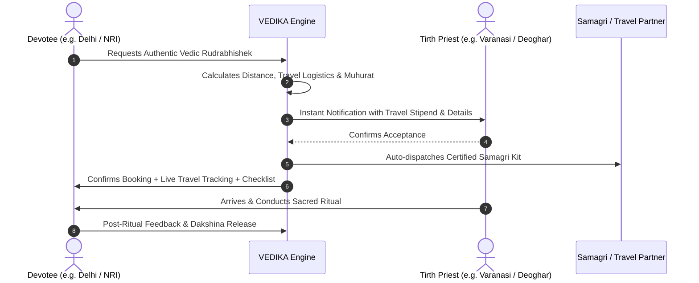

<div align="center">

# 🕉️ VEDIKA (वेदिका)
### *India’s Digital Vedic, Spiritual & Religious Services Ecosystem & Marketplace*

> **परंपरा, आपके द्वार।**  
> *Transforming India's fragmented devotional and spiritual landscape into a trusted, unified, modern technology platform.*

[]()
[]()
[]()
[]()

<br/>

[Overview](#-1-executive-overview) • [The Core Problem](#-2-the-core-problem--the-big-idea) • [Product Universe](#-3-the-vedika-service-universe) • [Inter-City Mobility](#-4-inter-city-pandit--ritual-dispatch) • [System Architecture](#-5-technology-architecture--system-design) • [Business Model](#-6-business--monetization-model) • [Complete Blueprint](#-7-complete-business-blueprint)

---

</div>

## 📖 1. Executive Overview

**VEDIKA (वेदिका)** is a full-stack digital marketplace and operating system designed to organize, standardize, and digitize India’s massive, multi-billion-dollar religious, spiritual, devotional, pilgrimage, and ritual services ecosystem.

From discovery and verified credentials to cross-city travel scheduling, standardized samagri delivery, escrow payments, and live streaming — VEDIKA replaces chaotic phone calls and local word-of-mouth with a seamless, high-trust digital infrastructure.

```
       [ Devotee / Customer ] 
                  │
       ┌──────────▼──────────┐
       │   VEDIKA PLATFORM   │ ◄─── AI Muhurat Engine & Smart Matcher
       └──────────┬──────────┘
                  │
 ┌────────────────┼────────────────┬────────────────┐
 │                │                │                │
▼                ▼                ▼                ▼
[ Verified       [ Samagri &      [ Temple SaaS    [ Bhajan/Katha   
  Acharyas ]       Kits Supply ]    & Darshan ]      Artists ]
```

---

## 💡 2. The Core Problem & The Big Idea

### ❌ The Status Quo ("Pandit Ji ka number hai?")
* **High Fragmentation:** 95%+ of religious and ritual bookings in India occur offline via unverified references.
* **Pricing Opacity:** Arbitrary pricing, lack of clarity on Dakshina vs. travel vs. Samagri costs.
* **Inter-City Roadblocks:** Extremely difficult for devotees living in Tier-1 metros or abroad to book authentic Vedic scholars from holy cities (Varanasi, Haridwar, Deoghar, Ujjain, Ayodhya, Puri, Tirupati).
* **Samagri Hassles:** Incomplete or low-quality ritual ingredients causing friction during auspicious ceremonies.

### ✅ The VEDIKA Solution
> **Select Ritual → Select Location/Tradition → Pick Verified Scholar → Select Samagri Kit → Escrow Pay → Track & Perform**

---

## 🌌 3. The VEDIKA Service Universe

| Vertical | Services Included | Value Proposition |
| :--- | :--- | :--- |
| **Pujas & Havans** | Rudrabhishek, Satyanarayan Katha, Griha Pravesh, Navchandi, Mahamrityunjaya | Verified Vedic purohits matched by language, tradition, and gotra. |
| **Sanskar & Milestones** | Vivah Sanskar, Namkaran, Mundan, Janeu (Upanayan), Antyeshti & Shraddha | End-to-end milestone management with ritual guidelines. |
| **Spiritual Performances** | Bhajan Mandalis, Kirtan Groups, Jagran Troupes, Classical Devotional Artists | Structured portfolio previews, transparent pricing & audio/video reels. |
| **Katha & Discourses** | Shrimad Bhagwat, Ram Katha, Shiv Puran, Spiritual Keynote Speakers | Booking management, venue planning, live-stream infrastructure. |
| **Temple & Teerth SaaS** | E-Darshan, Seva & Puja Booking, Prasad Delivery, Queue Optimization | Digitizing temple administration with transparent devotee ledger. |
| **Pure Samagri Marketplace** | Certified pure havan samagri, customized ritual kits, pre-packaged boxes | Standardized, unadulterated items delivered to doorstep prior to ritual. |

---

## 🚆 4. Inter-City Pandit & Ritual Dispatch

One of VEDIKA's core differentiators is its structured **Cross-City Priest Logistics Engine**:



---

## 🏗️ 5. Technology Architecture & System Design

VEDIKA is architected as an enterprise-grade, scalable multi-sided platform:

### High-Level Tech Stack
* **Web & Mobile Apps:** Next.js 16 (App Router), React Native / Flutter for Cross-Platform Consumer & Provider Apps.
* **Core API & Microservices:** Node.js / TypeScript, FastAPI (AI/Muhurat Engine).
* **Databases:** PostgreSQL (Relational transactions & bookings), Redis (High-speed caching & availability locks), Pinecone (Semantic search for rituals and scriptures).
* **Payments & Escrow:** UPI AutoPay, Razorpay / Stripe (Global NRI remittances), Smart Escrow Payouts.
* **Communication & Streaming:** WebRTC / LiveKit for E-Pujas and virtual consultations, WhatsApp Business Cloud API for real-time ritual alerts.

### Core Database Entities
* `User` (Devotee / Yajman)
* `Provider` (Pandit, Shastri, Acharya, Artist, Vendor)
* `ServiceCatalog` (Rituals, Havans, Kathas with tradition & Samagri manifests)
* `Booking` (State machine: `REQUESTED` ➔ `CONFIRMED` ➔ `DISPATCHED` ➔ `IN_PROGRESS` ➔ `COMPLETED` ➔ `SETTLED`)
* `Temple` (SaaS administration, daily sevas, darshan slots)
* `SamagriOrder` (E-Commerce inventory & kit fulfillment)

---

## 💰 6. Business & Monetization Model

1. **Marketplace Commission:** 10% – 20% platform take-rate on ritual service bookings.
2. **Samagri E-Commerce Margin:** 25% – 40% margin on certified pure puja kits and spiritual merchandise.
3. **Temple Management SaaS:** Tiered subscription (SaaS) for temples managing queues, donations, and accommodations.
4. **Event Management & Mega-Kathas:** Full-service event orchestration fee for multi-day religious festivals.
5. **VEDIKA Gold / Family Membership:** Annual subscription offering monthly sankalp pujas, personalized astrological muhurats, and priority booking.

---

## 📑 7. Complete Business Blueprint

The complete, unabridged **84-section architectural and business blueprint** is documented in [`VEDIKA_Business_Blueprint.md`](./VEDIKA_Business_Blueprint.md).

It covers:
- Complete Service Taxonomy (Havans, Kathas, Sanskars, Pilgrimages)
- Smart Matching & Dynamic Pricing Models
- Provider Verification & KYC Tiers (Veda Pathshala accreditation, background checks)
- Trust, Safety & Ethical Guidelines
- 5-Year Financial & Go-To-Market Projections

---

<div align="center">

### 🕉️ *हर घर परंपरा। हर दिल आस्था।*

**Repository Maintained by:** [@mohitraj8503](https://github.com/mohitraj8503)  
*Crafted for the future of India's spiritual economy.*

</div>
